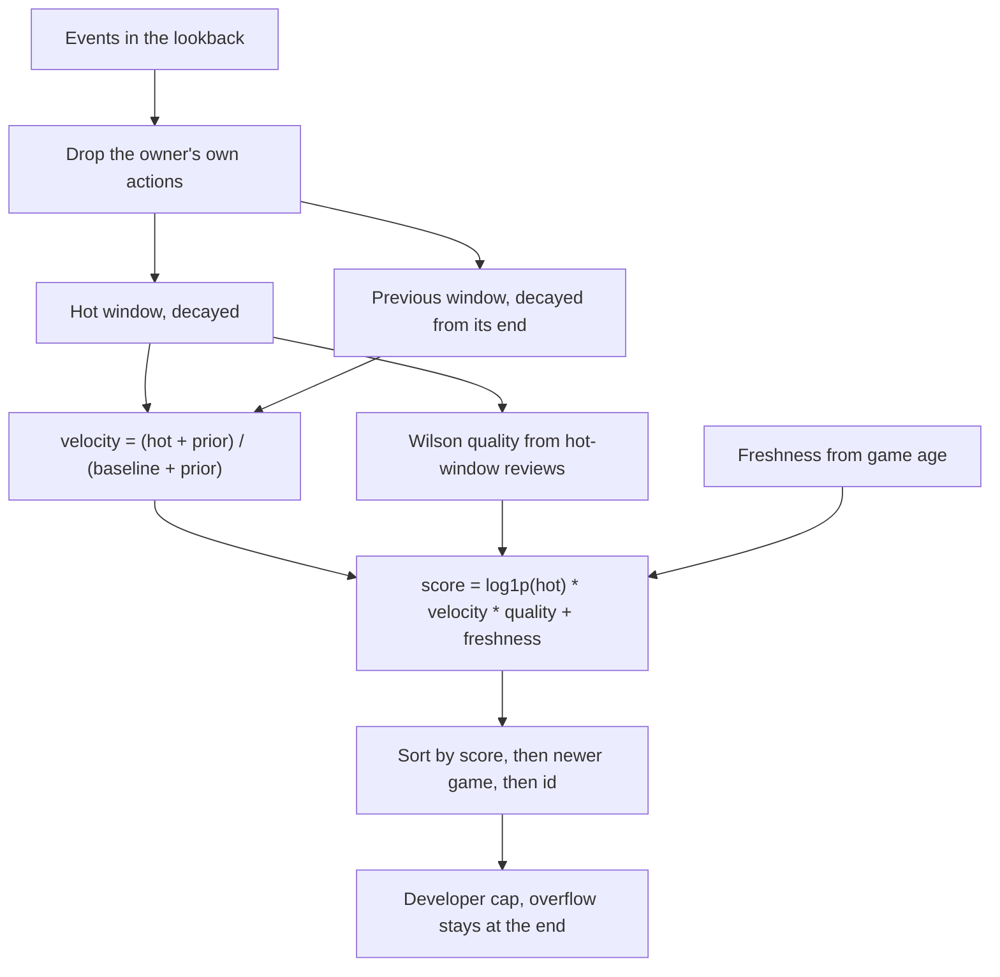
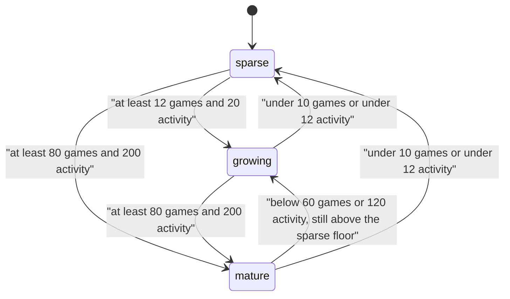
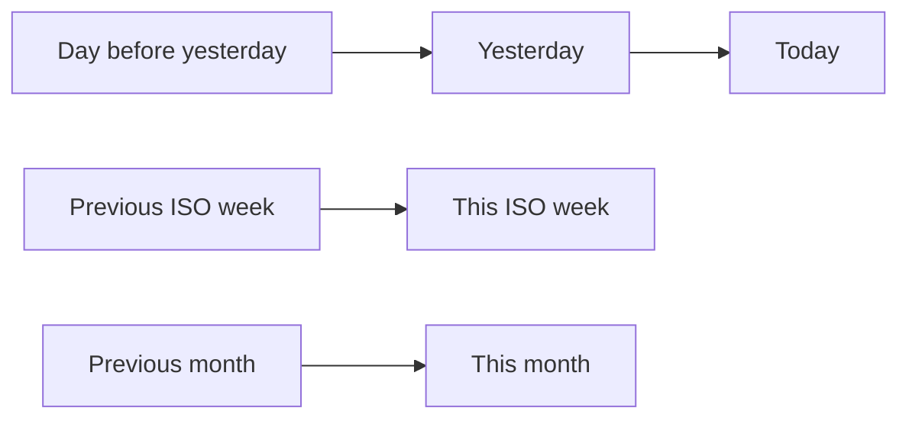
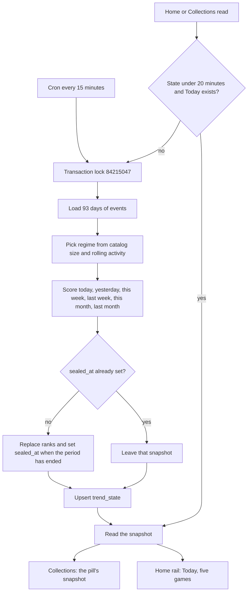

# Trending

Trending is a multi-signal velocity score. It answers which games are picking up attention in a calendar period.

The weekly launch board stays ranked by votes. A game can lead the week on votes and sit lower on Trending, or the other way around. The two lists do not share a rank.

Code lives in [`lib/trending/`](../lib/trending/). Constants are in [`config.ts`](../lib/trending/config.ts). The formula is in [`score.ts`](../lib/trending/score.ts). Calendar windows are in [`periods.ts`](../lib/trending/periods.ts). The refresh job is in [`recompute.ts`](../lib/trending/recompute.ts).

## Where it shows

| Surface | What it reads |
|---------|----------------|
| Home sidebar | Top 5 of **Today** (`TREND_RAIL_LIMIT`) |
| Collections, Trending tab | The selected pill, still in snapshot rank order after category, platform, and status filters |
| Later subscriber reports | A sealed snapshot, looked up by period kind and key |

Pills, left to right: **Today**, **1d**, **Week**, **Month**. The URL is `/collections?view=trending&range=today|1d|week|month`. Missing `range` means Today. See all on the home rail goes to `range=today`.

## How a score is built



Live catalog only: `games.archivedAt` is null. Taken-down games are archived, so they leave the list.

### Signals

Each event becomes a positive weight. Counts greater than 1 (visitor-days and link clicks) multiply the weight.

| Signal | Weight | Source |
|--------|--------|--------|
| Visitor | 1 | `game_analytics_visitors`, one row per game-day, count of distinct visitors |
| Click | 3, then capped | `game_analytics_daily.link_clicks` for that game-day |
| Like | 4 | `likes.created_at` |
| Bookmark | 5 | `bookmarks.created_at` |
| Vote | 6 | `votes.created_at` |
| Review | up to 8 | `game_reviews`, ignored when `removed_at` is set |

Visitor and click rows are stamped at 12:00 UTC on that day. If that noon is still in the future, the stamp is clamped to now, so today's partial day still falls inside Today.

Review hot weight is `8 * max(0, (rating - 3) / 2)`:

| Stars | Hot weight |
|-------|------------|
| 5 | 8 |
| 4 | 4 |
| 3 | 0 |
| 2 or 1 | 0 |

A 1-star review does not raise `hot`. It can still lower quality, below.

### Owner actions

Before scoring, any like, bookmark, vote, or review whose actor is the game's `owner_clerk_user_id` is removed. Visitors and clicks have no user id, so they stay. The owner key used later for the developer cap is `owner_clerk_user_id`, or `dev:` plus the developer name when the game has no owner.

### Click cap

Inside one window:

```text
clickScale = 1                         when there are no clicks
clickScale = min(1, 2 * visitors / clicks)
```

Zero visitors and any clicks means clicks contribute nothing. The cap is per game, per window, and it uses the raw counts in that window.

### Decay

```text
weight * 0.5 ^ (ageHours / halfLifeHours)
```

`ageHours` is measured backward from the **end** of the window being summed. Hot ends at `hotEnd`. The previous window ends at `hotStart` (exclusive), so an event just before the hot window is almost fresh in the baseline, and an event at the start of the baseline is the most decayed.

Half-life for the public lists comes from the period, not from the regime:

| Period | Half-life |
|--------|-----------|
| Today | 8 hours |
| 1d | 8 hours |
| Week | 2 days |
| Month | 7 days |

Regime half-lives (7 days, 3 days, 36 hours) apply only when `scoreTrendingGames` is called without an explicit window. The home rail and the Trending tab always pass a window.

### Velocity, quality, freshness

```text
velocity  = (hot + prior) / (baseline + prior)
quality   = 1                                      when the hot window has no reviews
quality   = 0.7 + wilsonLower(rating >= 4) * 0.45 otherwise
freshness = freshnessWeight * exp(-ageDays / 10)
score     = log1p(hot) * velocity * quality + freshness
```

`prior` and `freshnessWeight` come from the current regime. The prior stops one event from looking like infinite acceleration when the previous period was empty. `log1p(hot)` keeps a huge raw total from drowning velocity.

Quality uses every review in the hot window, including 1-star reviews that added no hot weight. The Wilson lower bound (z = 1.96) is the lower end of a 95% interval on the share of reviews that are 4 or 5 stars. No reviews leaves quality at 1, so a new game is not punished for silence. The multiplier sits between about 0.7 and 1.15.

`ageDays` is the game's `created_at` measured from `hotEnd`. A game created after the window end contributes no negative age.

### Order and the developer cap

Higher score first. Equal scores put the newer `created_at` first, then the smaller game id.

After that sort, a diversity pass limits how many games from one owner can lead the list. Games over the cap are moved behind the capped prefix. They stay on the list. Sparse mode has no cap.

| Regime | Prior | Freshness weight | Developer cap |
|--------|-------|------------------|---------------|
| sparse | 8 | 1.2 | none |
| growing | 4 | 0.6 | 3 |
| mature | 1.5 | 0 | 2 |

Sparse prior plus freshness means one recent like can beat a newer game with no activity, and a very old single event does not bury new games forever. Mature mode drops freshness, so a spike has to beat a flat history on velocity.

## Regimes

The regime is chosen once per refresh and then applied to every period scored in that run. It does not change the calendar windows. It changes prior, freshness, the developer cap, and the activity window used to decide the next regime.

Activity is the **undecayed** positive weight inside the previous regime's rolling hot window (21, 14, or 7 days ending now). The first run treats the previous regime as sparse, so it measures 21 days. That activity number is stored on `trend_state.event_mass`. Each snapshot also stores the positive activity inside its own hot window.



Leaving a regime is harder than entering it. Growing stays growing down to 10 games or 12 activity. Mature stays mature down to 60 games or 120 activity, and only falls all the way to sparse when the growing exit bars fail too.

`trend_state` keeps `regime`, `previous_regime`, `game_count`, `event_mass`, the regime's `window_days`, `half_life_hours`, and `prior_strength`. Those window and half-life columns describe the regime, not the 8-hour day list.

## Periods

Every public list compares a hot window with the equal period immediately before it. A closed window ends 1 millisecond before the next period starts, so an event exactly at the next midnight belongs to the next period.

| Pill | Hot window | Compared with | Key | Snapshot |
|------|------------|---------------|-----|----------|
| Today | UTC midnight through now | Yesterday | `2026-10-20` | Open, rewritten every refresh |
| 1d | The previous UTC day, the full day | The day before that | `2026-10-19` | Sealed |
| Week | Current ISO week, Monday 00:00 UTC through now | The previous ISO week | `2026-W43` | Open |
| Month | UTC month, the 1st through now | The previous UTC month | `2026-10` | Open |

Week numbers come from [`getIsoWeekUtc`](../lib/iso-week.ts), the same clock as the launch board.

The job also scores the previous ISO week and the previous month so those can be sealed. The pills do not show them. A report reads them by kind and key.



Today, this week, and this month are the hot windows the pills show. The box to the left of each is its baseline. 1d uses Yesterday as the hot window and the day before yesterday as the baseline.

Events are loaded for 93 days (`TREND_LOOKBACK_DAYS`). That covers this month, last month, and the month before last, so a sealed month still has a full baseline.

## Snapshots

`game_trend_scores` is one row per game and used to be replaced on every refresh. Nothing public reads it now. Rankings live in two tables in [`db/schema.ts`](../db/schema.ts).

`trend_snapshots` is unique on `kind` + `period_key`.

| Column | Meaning |
|--------|---------|
| `kind` | `day`, `week`, or `month` |
| `period_key` | `2026-10-20`, `2026-W43`, or `2026-10` |
| `starts_at`, `ends_at` | Hot window. Open rows move `ends_at` forward each refresh |
| `sealed_at` | Empty while the period is still open |
| `game_count`, `event_mass`, `regime` | Catalog size, hot-window activity, and the regime used for that write |
| `computed_at` | When this row was last written |

`trend_snapshot_ranks` stores `game_id`, `rank`, `score`, `hot`, `baseline`, and `velocity` for that snapshot. Rank 1 is the first game. Filters do not renumber ranks; they hide rows and keep the remaining order.

Old snapshots are kept. A sealed row is never rewritten, so a report for last week or last month stays stable after later votes and clicks.

## Refresh

[`vercel.json`](../vercel.json) calls `GET /api/cron/recompute-trends` every 15 minutes. Render staging hits the same route from the Blueprint cron in [`render.yaml`](../render.yaml). The route checks `CRON_SECRET` and always recomputes. A page read calls `ensureFreshTrends`, which skips the work when `trend_state.computed_at` is under 20 minutes old (`TREND_STALE_MS`) and Today's snapshot already exists. A fresh regime row with no Today snapshot still forces a recompute, so the first deploy after the tables exist fills them on the next page view.



Queries on the transaction client run one after another. The visitor aggregate is the slow part; scoring the six windows after that is in memory.

The lock id is `84215047`. Ad jobs use `84215045` and `84215046`, so those crons do not block each other.

## What a later report should read

There is no mail sender in this path. The record is the snapshot.

- Trending yesterday: `kind = day`, `period_key` of that UTC date, `sealed_at` set.
- Trending last week: `kind = week`, key like `2026-W42`, `sealed_at` set.
- Trending last month: `kind = month`, key like `2026-09`, `sealed_at` set.
- Trending so far today, this week, or this month: the matching open row. It still changes until the period ends.

Join `trend_snapshot_ranks` and order by `rank`.

## Checks

[`lib/trending/score.test.ts`](../lib/trending/score.test.ts) covers the formula edges worth keeping:

- No events sorts newest first, because the score is then only freshness.
- In sparse mode a recent like beats a newer game with no activity.
- In mature mode a spike beats a flat run of likes.
- A 1-star review does not raise the score above the same visitors with no review.
- The owner's like is dropped; a fan's like and a visitor row stay.
- An event today does not change yesterday's hot, baseline, or score.
- An event in the week before last does not change this week's hot or baseline.
- Regime changes use the hysteresis bars above.
